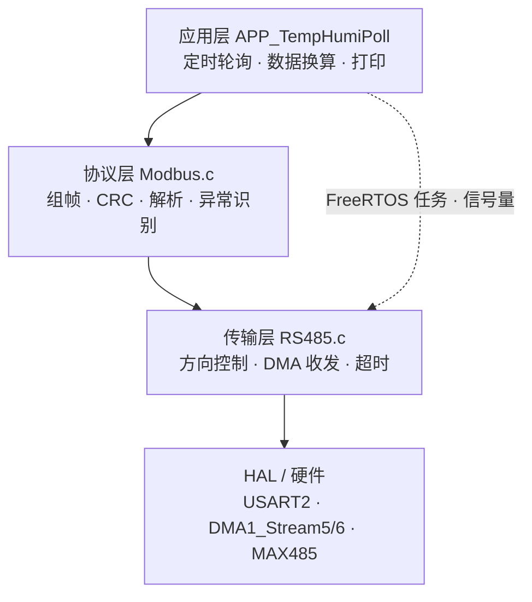

# RS485 / Modbus 通信层软件设计文档

| 版本 | 日期 | 说明 |
|---|---|---|
| v1.0 | 2026-11-06 | 初版。三层（RS485 传输 / Modbus 协议 / 应用）全部实现，实测读取温湿度成功 |

> 本文档与根目录 `项目文档.md` 配套：那份管**硬件选型与板级规划**，本份管**通信软件的实现细节**。
>
> ⚠ **引脚以本文为准**：`项目文档.md` 第 4 节的引脚表是 v0.1 草案（曾计划 USART6/PC6/PC7/PD7），实际实现已改为 **USART2 + PA2/PA3 + PE7**。两处不一致时以本文和代码为准。

---

## 1. 概述

### 1.1 目标

在 STM32F407VET6 + FreeRTOS 平台上，实现与 RS485 温湿度传感器（Modbus-RTU 从站）的可靠通信，要求：

- 收发全程 **DMA + 中断**，CPU 在传输期间不空转
- 支持**不定长帧**（正常应答 9 字节、异常应答 5 字节）
- 错误可分类定位，而不是笼统的"失败"
- 上层调用只需一行 `MB_ReadHoldingRegs()`，不关心时序细节

### 1.2 分层架构



**分层原则**：上层不知道下层怎么实现，下层不知道上层要干什么。

- `Modbus.c` 不知道用的是 USART2 还是 USART6，也不知道 MAX485 的 EN 脚在哪
- `RS485.c` 不知道什么是 CRC、什么是寄存器地址
- 换掉传感器型号，只改 `Modbus.c` 的设备参数；换掉串口，只改 `RS485.c` 的两行宏

---

## 2. 硬件接口

### 2.1 连接关系

```
STM32F407VET6                    MAX485 模块              温湿度传感器
─────────────────                ─────────────            ──────────────
PA2  (USART2_TX) ────────────→   TXD (DI)
PA3  (USART2_RX) ←────────────   RXD (RO)
PE7  (GPIO 输出) ────────────→   EN (DE/RE 并联)          A ──── A
                                 A ─────────────────────── B ──── B
                                 B                        + ──── 5V
GND  ──────────────────────────  GND                      − ──── GND
```

| 信号 | 引脚 | 说明 |
|---|---|---|
| USART2_TX | PA2 | 复用推挽 AF7 |
| USART2_RX | PA3 | 复用推挽 AF7 |
| MAX485_EN | PE7 | **高 = 发送，低 = 接收**，上电默认低 |

### 2.2 串口参数

| 参数 | 值 | 备注 |
|---|---|---|
| 波特率 | 9600 | 传感器出厂默认 |
| 数据位 | 8 | `UART_WORDLENGTH_8B` |
| 停止位 | 1 | |
| 校验位 | **无** | `UART_PARITY_NONE` |
| 流控 | 无 | 半双工，不需要 |

⚠ **STM32 的"字长"是含校验位的**：8 位数据 + 无校验 = `UART_WORDLENGTH_8B`；如果选了带校验的配置，必须用 `UART_WORDLENGTH_9B`。这一点配错会导致**从站完全不应答**（现象和"没接线"一模一样），是本项目踩过的最大坑之一。

### 2.3 DMA 与外设资源

| 资源 | 用途 | 中断优先级 |
|---|---|---|
| DMA1_Stream5 / Channel4 | USART2_RX | **6** |
| DMA1_Stream6 / Channel4 | USART2_TX | **6** |
| USART2_IRQn | TC / IDLE 事件 | **6** |
| TIM1 | HAL 时基（1ms） | 15 |
| SysTick | FreeRTOS tick | 15 |

**优先级为什么是 6**：FreeRTOS 的 `configLIBRARY_MAX_SYSCALL_INTERRUPT_PRIORITY = 5`，只有优先级**数值 ≥ 5** 的中断才能被临界区屏蔽、才允许在其中调用 `xxxFromISR` 系列 API。设成 0~4 会在 `configASSERT` 处直接停住。

---

## 3. 调用关系

```
任务上下文（TempHumi_Task）          中断上下文
──────────────────────────           ────────────────────────
MB_ReadHoldingRegs()
 ├ 组帧 + AppendCRC
 ├ RS485_Send()
 │   ├ ClearRX()
 │   ├ SetDir(1)  抢总线
 │   ├ HAL_UART_Transmit_DMA() ───→ DMA1_Stream6 TC 中断
 │   │                                └→ USART2 TC 中断
 │   │                                     └→ HAL_UART_TxCpltCallback()
 │   │                                          ├ SetDir(0) 交还总线
 │   │                                          └ Give(tx_done)
 │   └ Take(tx_done) ←────────────── 唤醒
 └ RS485_Recv()
     ├ HAL_UARTEx_ReceiveToIdle_DMA() ─→ 总线空闲 → IDLE 中断
     │                                    └→ HAL_UARTEx_RxEventCallback()
     │                                         ├ 记录实际长度
     │                                         └ Give(rx_done)
     └ Take(rx_done) ←───────────────── 唤醒
```

**等待期间任务处于阻塞态，CPU 交给其他任务**——这是本方案与阻塞轮询的核心差别。

---

## 4. RS485 传输层（`Core/Src/RS485.c`）

### 4.1 接口

```c
void RS485_Init(void);                                              /* 上电初始化 */
void RS485_ClearRX(void);                                           /* 倒掉接收残渣 */
int  RS485_Send(const uint8_t *buf, uint16_t len);                  /* 发送一帧 */
int  RS485_Recv(uint8_t *buf, uint16_t buf_size,
                uint16_t *out_len, uint32_t timeout_ms);            /* 接收一帧 */
```

| 函数 | 返回值 |
|---|---|
| `RS485_Send` | `RS485_OK` / `RS485_ERR_TX` / `RS485_ERR_ARG` |
| `RS485_Recv` | `RS485_OK` / `RS485_ERR_TMO` / `RS485_ERR_PE` / `RS485_ERR_ORE` / `RS485_ERR_ARG` |

### 4.2 错误码

```c
#define RS485_OK        0
#define RS485_ERR_TX   -1   /* 发送失败 / DMA 启动失败 */
#define RS485_ERR_TMO  -2   /* 接收超时，字节没凑齐 */
#define RS485_ERR_PE   -3   /* 校验错 / 帧错 / 噪声 */
#define RS485_ERR_ORE  -4   /* 溢出：没读走又来了新字节 */
#define RS485_ERR_ARG  -5   /* 参数非法 */
```

**为什么要分这么细**：现场出问题时，`-2`（没收到）和 `-3`（收到了但错了）对应的排查路径完全不同——前者查接线和供电，后者查干扰和波特率。笼统返回"失败"等于放弃诊断信息。

### 4.3 方向控制

```c
static void RS485_SetDir(uint8_t tx)
{
    HAL_GPIO_WritePin(MAX485_EN_GPIO_Port, MAX485_EN_Pin,
                      tx ? GPIO_PIN_SET : GPIO_PIN_RESET);
}
```

MAX485 的 DE（高有效，控制发送）与 RE（低有效，控制接收）**并联在一个 GPIO 上**：

| GPIO | DE | RE | 总线状态 |
|---|---|---|---|
| 0 | 0 | 0 | 接收（主站放手，从站说话） |
| 1 | 1 | 1 | 发送（主站驱动，从站闭嘴） |

该函数是 `static` 私有的——**上层不应关心总线方向**，那是传输层的职责。

### 4.4 发送流程

```c
int RS485_Send(const uint8_t *buf, uint16_t len)
{
    if (buf == NULL || len == 0) return RS485_ERR_ARG;

    (void)xSemaphoreTake(tx_done_sem, 0);   /* 清残留信号 */
    RS485_ClearRX();                        /* 清上一轮残渣 */
    RS485_SetDir(1);                        /* 抢总线 */

    if (HAL_UART_Transmit_DMA(&huart2, (uint8_t *)buf, len) != HAL_OK)
    {
        RS485_SetDir(0);                    /* ★ 失败也要交还总线 */
        return RS485_ERR_TX;
    }

    if (xSemaphoreTake(tx_done_sem, pdMS_TO_TICKS(RS485_TX_TIMEOUT_MS)) != pdTRUE)
    {
        (void)HAL_UART_AbortTransmit(&huart2);
        RS485_SetDir(0);
        return RS485_ERR_TX;
    }
    return RS485_OK;
}
```

**关键点一：切换时机必须是 TC，不是 TXE**

| 标志 | 含义 | 能否切回接收 |
|---|---|---|
| TXE | 数据寄存器空（字节已搬进移位寄存器） | ❌ 此时数据正在一位一位往外打 |
| **TC** | 发送完成（最后一位已移出） | ✅ |

按 TXE 切换会**截断帧尾**，从站收到半个字节 → CRC 错。

**关键点二：F4 HAL 的 `TxCpltCallback` 已经在 TC 之后**

`UART_DMATransmitCplt()` 在 DMA 搬运完成后只是 `ATOMIC_SET_BIT(CR1, USART_CR1_TCIE)` 打开 TC 中断，等真正的 TC 到来才调 `UART_EndTransmit_IT()` → `HAL_UART_TxCpltCallback()`。**所以回调里直接 `SetDir(0)` 是安全的**，不需要再等 TC。

**关键点三：每条失败路径都要 `SetDir(0)`**

漏掉任何一条，DE 会永久停在 1，总线被主站霸占，从站再也无法应答，且**不报任何错**。

### 4.5 接收流程

```c
void HAL_UARTEx_RxEventCallback(UART_HandleTypeDef *huart, uint16_t Size)
{
    BaseType_t woken = pdFALSE;

    if (huart->Instance == USART2)
    {
        rs485_rx_len = Size;                       /* 实际收到的字节数 */
        xSemaphoreGiveFromISR(rx_done_sem, &woken);
        portYIELD_FROM_ISR(woken);
    }
}
```

使用 `HAL_UARTEx_ReceiveToIdle_DMA()`：DMA 持续接收，**总线空闲（IDLE）时回调**，`Size` 就是实际字节数。

| 方案 | 能否处理不定长帧 | CPU 占用 |
|---|---|---|
| `HAL_UART_Receive()` 阻塞 | ❌ 必须预知长度 | 忙等，不让出 |
| `HAL_UART_Receive_DMA()` 固定长度 | ❌ 必须预知长度 | 低 |
| **`HAL_UARTEx_ReceiveToIdle_DMA()`** | ✅ 收到多少算多少 | 低 |

这正是本项目能处理"正常应答 9 字节 / 异常应答 5 字节"的关键。

### 4.6 关键时序参数

| 参数 | 值 | 依据 |
|---|---|---|
| 单字节传输时间 | 1.04 ms | 10 位 / 9600bps（8N1） |
| 8 字节请求帧 | 8.3 ms | |
| 9 字节应答帧 | 9.4 ms | |
| `RS485_TX_TIMEOUT_MS` | 100 ms | 约 12 倍余量 |
| `MB_RSP_TIMEOUT_MS` | 200 ms | 覆盖从站处理时间 |

---

## 5. Modbus 协议层（`Core/Src/Modbus.c`）

### 5.1 接口

```c
int MB_ReadHoldingRegs(uint8_t addr, uint16_t startReg,
                       uint16_t num, uint16_t *out);
int MB_WriteSingleReg(uint8_t addr, uint16_t reg, uint16_t val);
```

### 5.2 返回码

```c
#define MB_OK        0   /* 成功 */
#define MB_TIMEOUT   1   /* 发送失败 / 等应答超时 */
#define MB_CRC_ERR   2   /* CRC 校验不通过 */
#define MB_RSP_ERR   3   /* 应答字段不符 / 从站返回异常码 */
#define MB_PARAM_ERR 4   /* 调用方传参非法 */
```

### 5.3 CRC16/MODBUS

```c
static uint16_t Modbus_CRC16(const uint8_t *buf, uint16_t len)
{
    uint16_t crc = 0xFFFF;
    uint16_t i;

    for (i = 0; i < len; i++)
        crc = (crc >> 8) ^ crc16_table[(crc ^ buf[i]) & 0xFF];

    return crc;
}
```

| 项 | 值 |
|---|---|
| 生成多项式 | x¹⁶ + x¹⁵ + x² + 1，即 `0x8005` |
| 算法方向 | 右移（LSB first） |
| 反射多项式 | **`0xA001`**（`0x8005` 的 16 位镜像） |
| 初值 | `0xFFFF` |
| 发送字节序 | **低字节在前** |

**查表法的原理**：逐位算法每字节需循环 8 次；而"这 8 次的结果"只取决于 `(crc ^ byte) & 0xFF` 这 8 个 bit（256 种可能），所以预先把 256 种结果算好存表，运行时查一次即可，**快 8 倍**。

**验证基准**（改代码后必须核对）：

| 输入 | 正确输出 |
|---|---|
| `01 03 00 00 00 02` | `0x0BC4` → 发送顺序 `C4 0B` |
| `01 03 04 02 06 01 00 1A 1A`（含 CRC 的完整帧） | **`0x0000`** |

第二条是 Modbus 校验的标准技巧：**对含 CRC 的完整帧再算一次，结果必为 0**。

### 5.4 读保持寄存器（功能码 0x03）

**请求帧**（8 字节）：

```
01   03   00 00   00 02   C4 0B
地址  功能码  起始地址  寄存器数   CRC
```

**应答帧**（`5 + 2×num` 字节）：

```
01   03   04   02 06   01 00   1A 1A
地址  功能码  字节数  湿度    温度    CRC
```

**解析步骤与顺序**（顺序不能乱）：

| # | 步骤 | 失败返回 |
|---|---|---|
| 1 | 参数检查（`out != NULL`、`0 < num ≤ 8`） | `MB_PARAM_ERR` |
| 2 | 组帧 + 附 CRC | — |
| 3 | `RS485_Send()` | `MB_TIMEOUT` |
| 4 | `RS485_Recv()` 带实际长度 | `MB_TIMEOUT` |
| 5 | 最短帧检查（`rsp_len ≥ 5`） | `MB_RSP_ERR` |
| 6 | 整帧 CRC 应为 0 | `MB_CRC_ERR` |
| 7 | 异常应答（`rsp[1] & 0x80`） | `MB_RSP_ERR` |
| 8 | 字段校验（长度 / 地址 / 功能码 / 字节数） | `MB_RSP_ERR` |
| 9 | 大端转主机序，填入 `out[]` | — |

**为什么第 5 步必须在第 6 步之前**：`rsp_len` 是实际收到的字节数。如果只收到 3 字节，第 6 步的 CRC 计算会读到未初始化的内存，结果无意义。**先确认长度，再碰内容。**

**为什么第 7 步用 `rsp[1] & 0x80` 而不是 `== 0x83`**：从站返回异常时，把请求功能码最高位置 1（`0x03 | 0x80 = 0x83`）。用 `& 0x80` 判断对所有功能码通用，加新功能码时不用改这段。

### 5.5 字节序

Modbus 规定**所有多字节字段都是大端**（高字节先发），而 STM32 是小端：

```c
/* 正确：手动拆字节 */
req[2] = (uint8_t)(startReg >> 8);   /* 高字节 */
req[3] = (uint8_t)(startReg);        /* 低字节 */

/* 错误：直接强转会把低字节放前面 */
*(uint16_t *)&req[2] = startReg;
```

解析方向同理：

```c
out[i] = (uint16_t)((rsp[3 + 2*i] << 8) | rsp[4 + 2*i]);
```

---

## 6. 应用层（`Core/Src/APP/APP_TempHumiPoll.c`）

### 6.1 设备参数

```c
#define TH_SLAVE_ADDR       0x01     /* 从站地址 */
#define TH_REG_HUMI         0x0000   /* 湿度寄存器 */
#define TH_REG_TEMP         0x0001   /* 温度寄存器 */
#define TH_VAL_SCALE        10       /* 原始值 ÷ 10 = 物理值 */
#define TH_POLL_PERIOD_MS   2000     /* 轮询周期 */
```

全部集中在头文件 `APP_TempHumiPoll.h`，换传感器型号时只改这一处。

### 6.2 任务结构

```c
static void TempHumi_Task(void *pvParameters)
{
    TickType_t xLastWakeTime = xTaskGetTickCount();

    for (;;)
    {
        ret = MB_ReadHoldingRegs(TH_SLAVE_ADDR, TH_REG_HUMI, 2, regs);

        if (ret == MB_OK)
        {
            t_raw = (int16_t)regs[1];
            printf("[TH] Humi: %d.%d %%RH   Temp: %d.%d C\r\n",
                   regs[0] / TH_VAL_SCALE, regs[0] % TH_VAL_SCALE,
                   t_raw / TH_VAL_SCALE,  abs(t_raw % TH_VAL_SCALE));
        }
        else
        {
            printf("[TH] read fail, ret=%d\r\n", ret);
        }

        xTaskDelayUntil(&xLastWakeTime, pdMS_TO_TICKS(TH_POLL_PERIOD_MS));
    }
}
```

| 项 | 值 | 说明 |
|---|---|---|
| 优先级 | 3 | 高于 task1/task2 |
| 栈 | 384 字（1536 B） | `printf` 吃栈，不能给 128 |
| 周期 | 2000 ms | `xTaskDelayUntil` 保证严格等间隔 |

**为什么用 `xTaskDelayUntil` 而不是 `vTaskDelay`**：`vTaskDelay(2000)` 是"从现在起延迟 2s"，加上读取耗时（约 20ms）实际周期变成 2020ms 且每次抖动；`xTaskDelayUntil` 是"延迟到上次 + 2s"，**周期严格固定**。

### 6.3 数据换算

| 量 | 原始值 | 换算 | 示例 |
|---|---|---|---|
| 湿度 | `uint16_t` | ÷ 10 | `518` → 51.8 %RH |
| 温度 | **`int16_t`**（补码） | ÷ 10 | `256` → 25.6 ℃；`0xFF9B` = `-101` → -10.1 ℃ |

**两个必须注意的点**：

1. **温度必须转成有符号**。`0xFF9B` 按 `uint16_t` 读是 65435，按 `int16_t` 读才是 -101。
2. **小数部分要取绝对值**。C 语言里 `-101 % 10 == -1`（余数符号跟随被除数），不取绝对值会打成 `-10.-1`。

```c
t_raw / TH_VAL_SCALE,  abs(t_raw % TH_VAL_SCALE)   /* -10, 1 → "-10.1" */
```

---

## 7. 关键设计决策

| 决策 | 选择 | 理由 |
|---|---|---|
| 收发方式 | DMA + 中断 + 信号量 | 阻塞版在等待期间忙等，占用 CPU 约 20ms/次 |
| 帧结束判定 | IDLE 中断 | 天然支持不定长帧，无需预知应答长度 |
| 任务同步 | 二值信号量 | 等待时让出 CPU；`FromISR` 版本可在中断中释放 |
| 接收长度 | 运行时变量 `rsp_len` | 缓冲区大小用 `sizeof`，"实际用了多少"只能用变量 |
| 方向控制 | `static` 私有函数 | 上层不应关心总线方向 |
| 错误码 | 分层分类 | 现场调试时能直接定位到物理层 / 协议层 |
| 参数宏 | 集中定义在 `.h` | 换设备只改一处，除法除数最易漏改 |

---

## 8. 实测数据

### 8.1 正常读取

```
发送：01 03 00 00 00 02 C4 0B
应答：01 03 04 02 06 01 00 1A 1A
      │  │  │  └──┬──┘ └──┬──┘ └──┬──┘
      │  │  │     │       │       └── CRC (0x1A1A)
      │  │  │     │       └────────── 温度 0x0100 = 256 → 25.6℃
      │  │  │     └────────────────── 湿度 0x0206 = 518 → 51.8%RH
      │  │  └──────────────────────── 字节数 4
      │  └─────────────────────────── 功能码 0x03
      └────────────────────────────── 从站地址 0x01
```

### 8.2 串口输出

```
[TH] task start, 2000 ms
[TH] Humi: 55.9 %RH   Temp: 25.6 C
task1运行...
task2运行...
```

湿度随时间缓慢变化（55.9 → 55.8 → 55.7），证明是真实采集而非固定值。

### 8.3 自环测试（PA2 ↔ PA3 直连，跨过 MAX485）

```
发送：11 22 33 44 55 66 77 88
接收：11 22 33 44 55 66 77 88   len = 8
```

用于隔离"软件"与"硬件"问题——**这是排查通信故障最有效的一步**。

⚠ 自环必须**先启动接收再发送**（`HAL_UARTEx_ReceiveToIdle_DMA` 先挂起，再 `HAL_UART_Transmit_DMA`）。按"先发后收"的顺序数据早已跑完，必然超时。

⚠ 自环只能证明**链路通**，不能证明**参数对**——收发两端是同一套配置，波特率/校验位错了也照样通过。

---

## 9. 踩坑记录

按本项目实际遇到并解决的顺序整理，**每一条都曾导致过故障**。

| # | 现象 | 根因 | 解决 |
|---|---|---|---|
| 1 | 串口一个字都不输出 | `taskENTER_CRITICAL()` 后漏了 `taskEXIT_CRITICAL()`，`BASEPRI` 永久屏蔽，SysTick/TIM1 全停 | 严格配对；`vTaskDelete` 必须是最后一句 |
| 2 | 加测试代码后彻底无输出 | `start_task` 栈 128 字（512B）装不下 `printf` + 函数嵌套 → 栈溢出钩子死循环 | 栈改 512 字；含 `printf` 的任务至少 256 字 |
| 3 | `send=0` 但 `recv=-2`（无应答） | 串口配成 8**E**1，传感器是 8**N**1 | `WordLength=8B` + `Parity=NONE` |
| 4 | `L6218E: Undefined symbol` | `.c` 改了函数签名，`.h` 没同步 | 改签名必须同步头文件 |
| 5 | 编译报 `undefined identifier crc16_table` | CRC 表写在文件末尾，函数在上面引用 | 定义必须在使用之前 |
| 6 | CRC 全错，但编译零警告 | 表只写了 `/* ... */` 占位 → 256 个元素全为 0（C 语言部分初始化） | 补全 256 项 |
| 7 | 第一次发送就卡死 | 在 ISR 里调用 `xSemaphoreGive`（非 `FromISR`）→ `vPortEnterCritical` 断言失败 | 改用 `xSemaphoreGiveFromISR` + `portYIELD_FROM_ISR` |
| 8 | 总线被永久霸占，从站不应答 | `TxCpltCallback` 里漏了 `SetDir(0)` | 每条退出路径都要交还总线 |
| 9 | 自环测试必然超时 | 先发后收，数据在接收启动前已跑完 | 先启动接收，再发送 |
| 10 | 中断优先级设 0 时偶发死机 | 优先级 < 5 的中断不受 FreeRTOS 临界区管理，在其中调用 `FromISR` 会断言失败 | 统一改为 6 |
| 11 | `printf("ret=%d, len=%u", func(&n), n)` 打出 `len=0` | C 语言函数参数求值顺序未定义，可能先读 `n` 再调函数 | 拆成两行 |
| 12 | `recv` 拿到脏长度 | 先 `*out_len = ...` 再检查越界 | 先检查后赋值 |

---

## 10. 调试方法

### 10.1 分层排查顺序

**永远从下往上，不要跳层。** 下层不通时，上层的一切调试都是浪费时间。

```
① 电气层  →  量 PE7 电平；量 A/B 差分；确认模块供电 3.3V
② 链路层  →  PA2↔PA3 自环，数据一致？
③ 参数层  →  波特率 / 数据位 / 校验位 / 停止位 与对端一致？
④ 协议层  →  用已知帧核对 CRC（0BC4）
⑤ 应用层  →  数据换算、负温处理
```

### 10.2 常见返回码对照

| 返回码 | 含义 | 优先排查 |
|---|---|---|
| `RS485_ERR_TX (-1)` | 发送失败 | PE7、DMA 配置 |
| `RS485_ERR_TMO (-2)` | 接收超时 | A/B 接线、传感器供电、波特率 |
| `RS485_ERR_PE (-3)` | 校验/帧错 | 干扰、共地、参数不匹配 |
| `MB_CRC_ERR (2)` | 收到了但 CRC 不对 | 帧被截断、`rsp_len` 异常 |
| `MB_RSP_ERR (3)` | 字段不符或从站异常 | 打印 `rsp` 前 5 字节看是否 `0x83`/`0x86` |
| `MB_PARAM_ERR (4)` | 参数非法 | `num` 为 0 或超过 8 |

### 10.3 常用临时手段

```c
/* 打印接收原始字节 */
for (i = 0; i < rsp_len; i++) printf("%02X ", rsp[i]);
printf("  len=%u\r\n", rsp_len);

/* 查任务栈还剩多少（小于 50 就危险） */
printf("stack free = %u\r\n", uxTaskGetStackHighWaterMark(NULL));
```

---

## 11. 扩展方向

| 方向 | 说明 | 注意事项 |
|---|---|---|
| **多从站** | 总线上挂多个不同地址的传感器 | 轮询改为遍历地址；超时要缩短，避免一个离线拖累全部 |
| **总线互斥** | 多个任务共用 RS485 | 用 `xSemaphoreCreateMutex()` 保护 `RS485_Send/Recv` 这对操作，**不能用临界区**（收发要 20ms，关中断是灾难） |
| **写寄存器** | 修改从站地址、波特率 | 改地址后原地址失效，需断电重启；建议先做只读验证 |
| **RTU 帧间隔** | 严格按 3.5 字符时间切帧 | 当前用 IDLE（1 字符时间）代替，9600bps 下足够 |
| **异常码细分** | 把 `rsp[2]` 透传给上层 | 1=非法功能 2=非法地址 3=非法数据值 4=从站故障 |
| **数据上报** | 接入 W5500 或屏幕显示 | 建议用队列把数据从采集任务传给显示任务，不要在采集任务里直接刷屏 |

---

## 12. 文件清单

| 文件 | 职责 | 行数（约） |
|---|---|---|
| `Core/Inc/RS485.h` | 传输层接口 + 错误码 | 36 |
| `Core/Src/RS485.c` | 方向控制、DMA 收发、回调、信号量 | 130 |
| `Core/Inc/Modbus.h` | 协议层接口 + 功能码 + 返回码 | 50 |
| `Core/Src/Modbus.c` | CRC 表、组帧、读/写寄存器、解析 | 160 |
| `Core/Inc/APP/APP_TempHumiPoll.h` | 设备参数 + 任务配置 + 接口 | 35 |
| `Core/Src/APP/APP_TempHumiPoll.c` | 采集任务实现 | 70 |
| `Core/Src/usart.c` | USART1/2 初始化、DMA 链接、NVIC | — |
| `Core/Src/dma.c` | DMA 时钟与中断优先级 | — |
| `Core/Src/stm32f4xx_it.c` | `USART2_IRQHandler` 等中断入口 | — |

**依赖关系**：`APP → Modbus → RS485 → HAL`，单向依赖，不允许反向调用。

---

## 13. 修订记录

- **v1.0（2026-11-06）**：初版。记录 USART2 + MAX485 的 RS485 传输层（DMA 收发 + IDLE 中断 + 信号量同步）、Modbus-RTU 协议层（CRC16 查表、0x03/0x06 功能码、异常应答识别）、应用层（2s 轮询、温湿度换算）；收录实测帧数据与 12 条踩坑记录；给出分层调试方法与扩展方向。
